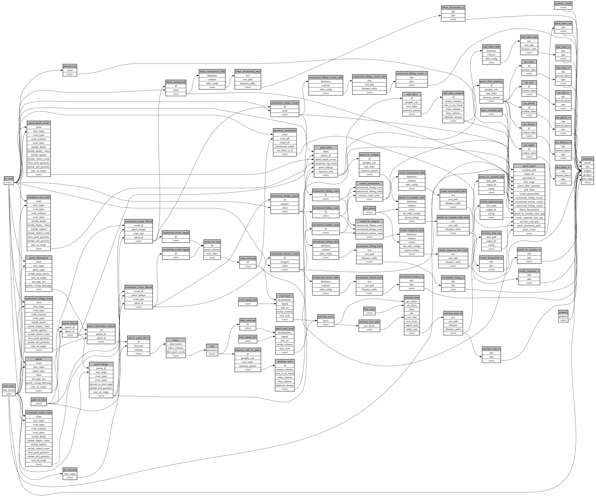

```
# AUTOGENERATED BY ECOSCOPE-WORKFLOWS; see fingerprint in README.md for details

```

```yaml
# fingerprint:
artifacts_sha256_basic: 1e075072ad38cf2dba581ae2f3f6c3d581c2765c1da1dcaf0044765bb2c94fb0
artifacts_sha256_strict: fb02d989d2c11934348e34953e7148e3a366808eb4cce886df51cb4f029523ad
installed_requirements:
- channel: https://repo.prefix.dev/ecoscope-workflows/
  name: ecoscope-platform
  version: {version: ==2.25.3}
- channel: https://repo.prefix.dev/ecoscope-workflows-custom/
  name: ecoscope-workflows-ext-custom
  version: {version: ==0.1.1}
- channel: conda-forge
  name: pydeck
  version: {version: ==0.9.2}
- channel: https://repo.prefix.dev/ecoscope-workflows-custom/
  name: ecoscope-workflows-ext-belize
  version: {version: ==0.0.3}
params_sha256: 5fb283a5b7694af145322359ed9b62eba85403ba37771a91aa8c7b030767b085
spec_sha256: 19b68100ff5599f8e3c2392bd5b06f52a04ab234744d7ee4e6488953fafa060c

```

# ecoscope-workflows-belize-patrol-report-workflow


